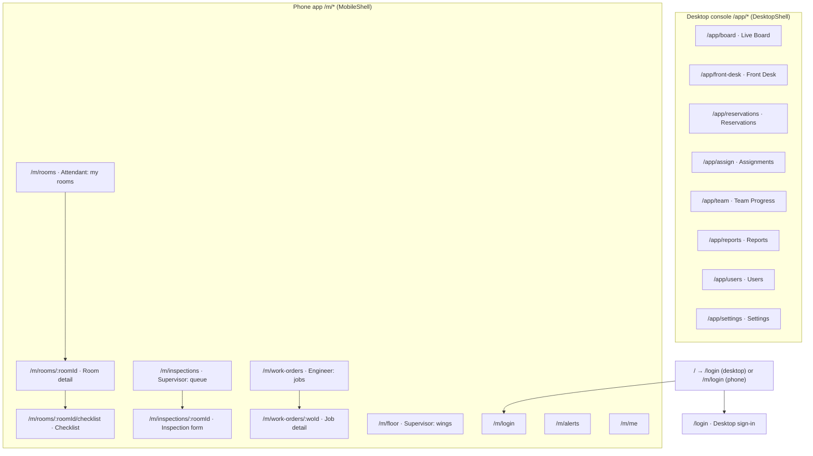

# Sitemap

Every URL in the app, who it is for, and what lives on it. Routes are TanStack Start file routes in `src/routes/`; screen components live in `src/components/hms/`. **Update this file whenever you add, rename or remove a route or a major overlay.**

Entry starts at sign-in. Switching desktop/phone also opens the destination sign-in screen. These are simulated client-side preview flows, not real authentication; existing workspace links remain directly accessible.

## Desktop console (`/app/*`)
Sidebar order as in `desktop-shell.tsx`. Personas: Manager (all pages), Front Desk (Front Desk + Reservations only), Admin (Users, Settings, Live Board, Reports); switch in the account menu. Every page has the **notification bell** (top right of the page heading; on the Live Board it sits on the welcome photo). Since 2026-11-18 the dashboard only covers what the staff app (EmG38/hotel-hearth-ops) also covers, so maintenance is not on the dashboard.

| URL | Screen (component) | Main persona | What it answers / does |
|---|---|---|---|
| `/app/board` | Live Board (`BoardPage`) | Manager | Welcome hero (readiness gauge + bell), readiness ribbon (filters), rooms grouped by wing, staff timeline. Click a tile → **Room drawer**. |
| `/app/front-desk` | Front Desk (`FrontDeskPage`) | Front Desk | Room status only (Ready / Not ready / Arrivals / Occupied), guests waiting, **requests to housekeeping** (towels, amenities, extra housekeeping, late checkout) sent to the floor supervisor's phone with Sent → On the way → Done. |
| `/app/reservations` | Reservations (`reservations-page.tsx`) | Front Desk | New reservation (name, phone, dates, nights, guests, room type, expected time, VIP, source); assign a room on the day; check in; **Follow up** tab for guests not arrived 30 min after their time (log call: still coming + new time, no answer, cancelled, no-show). Sidebar count + bell reminder. |
| `/app/assign` | Assignments (`AssignPage`) | Manager | Assign and re-assign rooms to attendants by wing; auto-assign; publish. |
| `/app/team` | Team Progress (`TeamPage`) | Manager | Each attendant's rooms done / in progress, supervisors by wing, accountability signals. Opens **Staff day** dialog. |
| `/app/reports` | Reports (`ReportsPage` → `ReportsContent`) | Manager | Charts (turn times, pass rate, re-cleans), PNG/CSV export, report preview. |
| `/app/users` | Users (`users-page.tsx`) | Manager / Admin | Create, edit, deactivate/reactivate team members; photo (upload or camera, optional; shown on staff sign-in), job, shift, wings (supervisors), phone or work email. Staff-app jobs get a one-time 4-digit PIN (reset any time); dashboard jobs get a one-time temporary password. |
| `/app/settings` | Settings (`SettingsPage`) | Admin | Property, checklists, inspection rules: inspection required, pass score, queue-guest SLA, attendant credit target. |
| `/app/escalations`, `/app/work-orders` | redirect to `/app/board` | — | Removed 2026-11-18 (bell replaces Escalations; maintenance isn't in the staff app). Kept as redirects so old links don't break. |
| `/login` | Desktop sign-in (`DesktopLoginPage`) | All | Split screen: courtyard illustration + night form (no real auth). |

**Overlays on desktop** (not URLs): Notification bell popover (`notifications.tsx`), Room drawer (`room-drawer.tsx`: readiness, supervisor-confirmed state, facts, actions, Supervisor checks + Timeline tabs; no attendant checklist since 2026-11-18; Front Desk sees only readiness, supervisor check, occupancy/arrival/open requests and Check in / Check out / Send request), Send request, Queue guest, Staff day, Event log, Report preview, Settings dialogs (`desktop-dialogs.tsx`), Create/Edit user + one-time PIN (`users-page.tsx`), New reservation + Follow-up call (`reservations-page.tsx`), Account menu (account switch, restore sample data).

## Phone app (`/m/*`)
Shown inside a generic Android phone frame (shared hotel devices). Bottom tab dock depends on persona (`mobile-shell.tsx`): Attendant = Rooms · Alerts · Me; Supervisor = Inspect · Wings · Alerts · Me; Engineer = Jobs · Alerts · Me. Language: English default, Arabic RTL via the EN / ع switch (one language per screen).

| URL | Screen (component) | Persona | What it does |
|---|---|---|---|
| `/m/login` | `MobileLoginPage` | All | Picture-first: pick job (Housekeeping, Supervisor) → tap your face → PIN. People created on `/app/users` appear here and must use their PIN; deactivated people don't appear. Full-screen (no tabs). |
| `/m/rooms` | `MobileRoomsPage` | Attendant | My shift: assigned rooms in priority order (queue guests first). |
| `/m/rooms/:roomId` | `MobileRoomDetailPage` | Attendant | Full-bleed room hero that collapses on scroll; room info, heritage notices, start / pause / report issue / DND. |
| `/m/rooms/:roomId/checklist` | `MobileChecklistPage` | Attendant | Zone-by-zone checklist with meter; finish → Awaiting inspection. |
| `/m/inspections` | `MobileInspectionsPage` | Supervisor | Inspection queue. |
| `/m/inspections/:roomId` | `MobileInspectionFormPage` | Supervisor | Scored inspection incl. heritage check; pass → Ready (internal), fail → re-clean. |
| `/m/floor` | `MobileFloorPage` | Supervisor | Wing-by-wing room grid. |
| `/m/work-orders` | `MobileWorkOrdersPage` | Engineer | My jobs. |
| `/m/work-orders/:woId` | `MobileWorkOrderDetailPage` | Engineer | Accept, work, resolve a job. |
| `/m/alerts` | `MobileAlertsPage` | All | Notifications for the current persona. Supervisor sees reception requests for their wings with **On my way** / **Done**. |
| `/m/me` | `MobileMePage` | All | Profile, shift, switch account. |

File-name note: `rooms_.$roomId.tsx` uses the trailing `_` to **un-nest** the route from `/m/rooms` (separate page, not a child). See `src/routes/README.md`.
