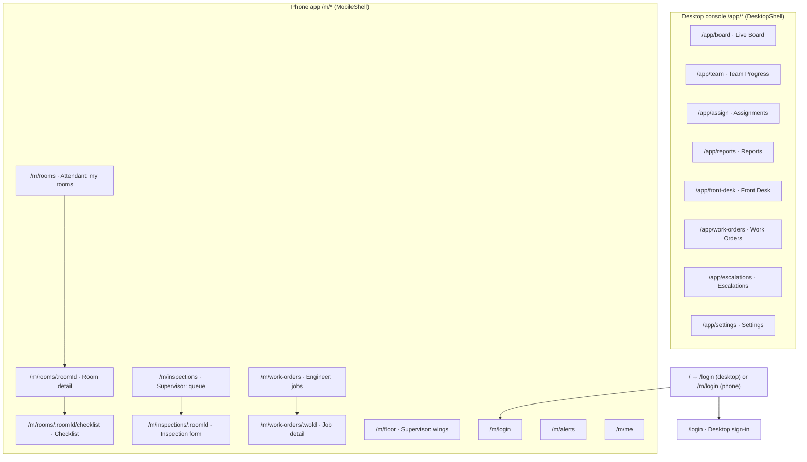

# Sitemap

Every URL in the app, who it is for, and what lives on it. Routes are TanStack Start file routes in `src/routes/`; screen components live in `src/components/hms/`. **Update this file whenever you add, rename or remove a route or a major overlay.**

Entry starts at sign-in. Switching desktop/phone also opens the destination sign-in screen. These are simulated client-side preview flows, not real authentication; existing workspace links remain directly accessible.

## Desktop console (`/app/*`)
Sidebar order as in `desktop-shell.tsx`. Personas: Manager, Front Desk, Admin (switch in the account menu).

| URL | Screen (component) | Main persona | What it answers / does |
|---|---|---|---|
| `/app/board` | Live Board (`BoardPage`) | Manager | "What needs me now?" Needs-you-now strip, readiness ribbon (filters), rooms grouped by wing. Click a tile → **Room drawer**. |
| `/app/team` | Team Progress (`TeamPage`) | Manager | Each attendant's rooms done / in progress, anomalies. Opens **Staff day** dialog. |
| `/app/assign` | Assignments (`AssignPage`) | Manager / Supervisor | Assign and re-assign rooms to attendants by wing. |
| `/app/reports` | Reports (`ReportsPage` → `ReportsContent`) | Manager | Charts (turn times, pass rate, re-cleans), PNG/CSV export, report preview. |
| `/app/front-desk` | Front Desk (`FrontDeskPage`) | Front Desk | Which rooms are Ready (internal); arrivals timeline with estimated ready time; queue a waiting guest. |
| `/app/work-orders` | Work Orders (`WorkOrdersPage`) | Manager / Engineering | Maintenance list, create and open work orders, OOO/OOS blocks. |
| `/app/escalations` | Escalations (`EscalationsPage`) | Manager | Anomalies, overdue rooms, heritage reports; one primary action per row. |
| `/app/settings` | Settings (`SettingsPage`) | Admin | Property rules: inspection required, pass score, queue-guest SLA, P1 accept time, DND welfare hours, attendant credit target. |
| `/login` | Desktop sign-in (`DesktopLoginPage`) | All | Split screen: courtyard illustration + night form (no real auth). |

**Overlays on desktop** (not URLs): Room drawer (`room-drawer.tsx`), Queue guest, Work order, New work order, Staff day, Event log, Report preview, Settings dialogs (`desktop-dialogs.tsx`), Account menu (account switch, restore sample data).

## Phone app (`/m/*`)
Shown inside a generic Android phone frame (shared hotel devices). Bottom tab dock depends on persona (`mobile-shell.tsx`): Attendant = Rooms · Alerts · Me; Supervisor = Inspect · Wings · Alerts · Me; Engineer = Jobs · Alerts · Me. Language: English default, Arabic RTL via the EN / ع switch (one language per screen).

| URL | Screen (component) | Persona | What it does |
|---|---|---|---|
| `/m/login` | `MobileLoginPage` | All | Picture-first: pick job → tap your face → PIN. Full-screen (no tabs). |
| `/m/rooms` | `MobileRoomsPage` | Attendant | My shift: assigned rooms in priority order (queue guests first). |
| `/m/rooms/:roomId` | `MobileRoomDetailPage` | Attendant | Full-bleed room hero that collapses on scroll; room info, heritage notices, start / pause / report issue / DND. |
| `/m/rooms/:roomId/checklist` | `MobileChecklistPage` | Attendant | Zone-by-zone checklist with meter; finish → Awaiting inspection. |
| `/m/inspections` | `MobileInspectionsPage` | Supervisor | Inspection queue. |
| `/m/inspections/:roomId` | `MobileInspectionFormPage` | Supervisor | Scored inspection incl. heritage check; pass → Ready (internal), fail → re-clean. |
| `/m/floor` | `MobileFloorPage` | Supervisor | Wing-by-wing room grid. |
| `/m/work-orders` | `MobileWorkOrdersPage` | Engineer | My jobs. |
| `/m/work-orders/:woId` | `MobileWorkOrderDetailPage` | Engineer | Accept, work, resolve a job. |
| `/m/alerts` | `MobileAlertsPage` | All | Notifications for the current persona. |
| `/m/me` | `MobileMePage` | All | Profile, shift, switch account. |

File-name note: `rooms_.$roomId.tsx` uses the trailing `_` to **un-nest** the route from `/m/rooms` (separate page, not a child). See `src/routes/README.md`.
